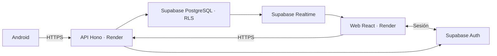

# Arquitectura

La arquitectura aprobada utiliza React con Vite en Render Static Site, Node.js con Hono en Render Web Service, Supabase PostgreSQL, Auth y Realtime, y Kotlin con Compose en Android.

El diagrama describe el sistema objetivo. La etapa 2 entrega los puntos de arranque de web, API y Android. npm workspaces integra `apps/web`, `apps/api` y `packages/shared`. Android se construye desde `apps/android`.

Etapas posteriores incorporan el panel y sus componentes shadcn/ui, el agente de captura, la integración, el despliegue y la preparación comercial. Las notificaciones detectadas y los pagos verificados se representarán mediante estados separados.

La etapa 3 incorpora el esquema relacional y sus políticas. PostgreSQL delimita las lecturas por empresa y sucursal. Las credenciales de dispositivo y los datos de diagnóstico residen en el esquema privado. Las altas y los cambios de pagos y eventos se publican mediante Realtime. Véase [Base de datos](database.md).

La etapa 4 implementa la API de negocio. El cliente Supabase autentica usuarios y gestiona invitaciones. Un pool de PostgreSQL permite ejecutar transacciones con autorización, auditoría y escritura atómicas dentro de la base. El endpoint de ingesta deriva el ámbito empresarial de la credencial del dispositivo y acepta reintentos con el mismo identificador. Véase [API HTTP](api.md).
